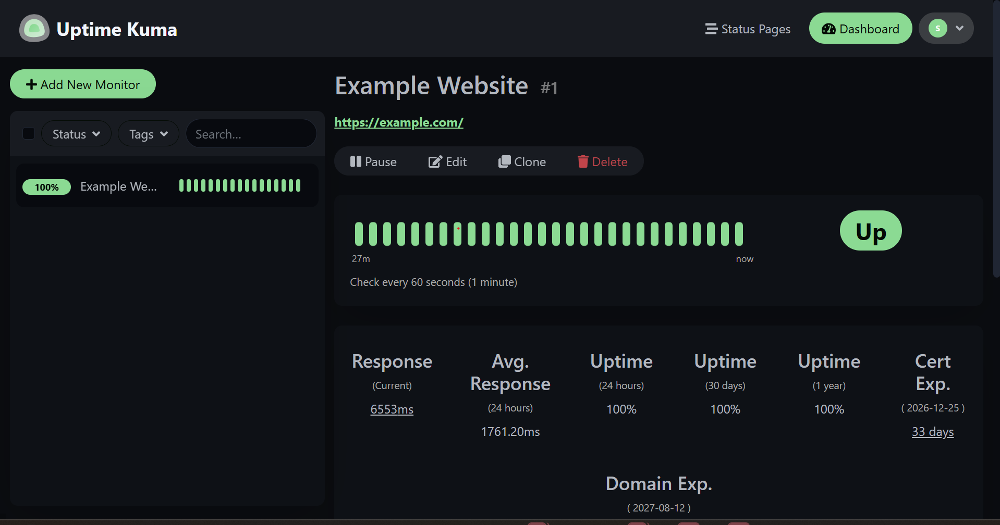

Installing Uptime Kuma Using Docker and Docker Compose

Introduction

For the assignment, I installed Docker and Docker Compose on an Ubuntu Server virtual machine using Proxmox. I chose Uptime Kuma, an open-source application that monitors websites and services to check if they were either online or offline.

The purpose of this project was to learn how I was to install Docker, deploy an application using Docker Compose, and make sure that the application worked correctly.

## Installing Docker and Docker Compose

I started by accessing my Ubuntu Server VM through the Proxmox noVNC console.

I then updated the package list by using the following command: 

sudo apt update

Then, I installed the packages needed to prepare for Docker installation:

sudo apt install -y ca-certificates curl

After that, I installed Docker and Docker Compose using:

sudo apt install -y docker.io docker-compose-v2

After installation, I made sure that both of the programs were installed successfully by running:

docker --version
docker compose version

The terminal confirmed that the Docker version 29.1.3 and Docker Compose version 2.40.3 were installed.

Installing and Setting Up Uptime Kuma

After I installed both Docker and Docker Compose, I created a folder for my Uptime Kuma application using these commands:

mkdir -p ~/uptime-kuma
cd ~/uptime-kuma
Then I downloaded Docker Compose configuration file by using:
curl -Lo compose.yaml https://raw.githubusercontent.com/louislam/uptime-kuma/master/compose.yaml

I checked the contents of the file using:
cat compose.yaml

Then I started on Uptime Kuma using:
sudo docker compose up -d

Docker then downloaded Uptime Kuma image and started container on successfully.

After, I opened Uptime Kuma in my browser by using my Ubuntu Server's IP address and port 3001. I then selected SQLite as database and created administrator account. 

Docker Compose Configuration

I used Docker Compose configuration file called compose.yaml in order to run Uptime Kuma.

The configuration used the louislam/uptime-kuma:2 Docker image. It also mapped port 3001 on Ubuntu Server to port 3001 in container, which allowed me to open the application in a web browser.

The configuration also used a volume to store application data so that the monitoring settings are saved when container restarts. 

I used the below command to start the application: 
sudo docker compose up -d

### My Docker Compose File

The following configuration below was used to deploy Uptime Kuma:

services:
  uptime-kuma:
    image: louislam/uptime-kuma:2
    container_name: uptime-kuma
    volumes:
      - ./data:/app/data
    ports:
      - "3001:3001"
    restart: unless-stopped

This configuration tells Docker to download and run Uptime Kuma, make the application accessible through port 3001, and store its data in a persistent folder.

The `restart: unless-stopped` setting allows Docker to restart container automatically unless it is manually stopped.

Testing Uptime Kuma

After I launched Uptime Kuma, I opened the application in my browser using my Ubuntu Server's IP address and port 3001.

I selected SQLite as the database and then created an administrator account.

To test said application, I clicked Add New Monitor and entered the following information:

Monitor Type: HTTP(s)

Friendly Name: Example Website

URL: https://example.com

Heartbeat Interval: Default setting

After saving the monitor, Uptime Kuma successfully checked the website.

The dashboard displayed:

Status: Up (Online)

Uptime: 100% for the checks completed

HTTP Response: 200 OK

This confirmed that my Uptime Kuma application was running and could successfully monitor any website.

Conclusion

Overall, I successfully deployed Uptime Kuma and verified that it was working.
All in all, I learned how install both Docker and Docker Compose on Ubuntu Serve VM hosted in Proxmox. I also learned how to
deploy application by using Docker Compose configuration file, how to acess application through web browser, and monitor 
website availability. An issue I faced was writing long commands into Proxmox noVNC terminal. I worked around it by writing
shorter commands into it and downloading the official Docker Compose configuration file. 

## Uptime Kuma Screenshot

The screenshot below shows my Uptime Kuma application successfully monitoring Example Website with 100% uptime.

